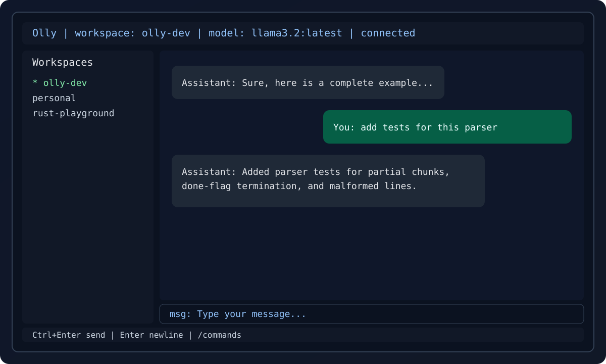

# Olly

Olly is a Rust terminal UI client for Ollama. It focuses on a fast chat loop for coding workflows with streaming responses, workspace history, and practical keyboard-driven UX.



## Features

- Streaming chat with live token rendering.
- Model listing and quick model switching.
- **Tool execution for coding workflows** (read_file, list_dir, grep_search, find_by_name, execute_command with safety restrictions).
- Workspace and per-workspace session persistence with SQLite.
- Full-text search over stored messages.
- File-context ingestion with safety guardrails.
- Markdown rendering with optional syntax highlighting.
- Slash-command power features (`/search`, `/export`, `/checkpoint`, `/workspace`, `/session`, `/attach`, `/model`, `/url`, `/tools`).
- Configurable keybindings and runtime Ollama URL.
- 8 built-in UI themes with live preview.
- Improved Windows console stability: startup sizing is normalized and resize handling avoids native scrollbar/layout glitches.
- Mouse-wheel chat scrolling with bounded overscroll behavior and consistent speed.
- **Right-click paste support** with cross-platform clipboard integration.
- **Mouse drag text selection and Ctrl+C copy** for chat messages with visual highlighting.
- **Drag-to-scroll selection** — auto-scroll activates when dragging near chat edges.
- **Shift+click range selection** — click to set anchor, Shift+click to select range.
- Per-session footer telemetry including context usage (`ctx:used/max`) against model context window.
- Footer context telemetry is restored across app restarts for the same session/model context.

## Documentation

| Document | Purpose |
|----------|---------|
| [Architecture](docs/architecture.md) | Module hierarchy, data flow, tool system design |
| [Features](docs/features.md) | Complete feature catalog, shortcuts, commands |
| [Workflow](docs/workflow.md) | Event loop, input pipeline, rendering cycle |
| [Testing](docs/testing.md) | Test strategy, patterns, coverage guidelines |
| [Design & UI/UX](docs/design-ui-ux.md) | Layout, themes, selection, modals, marquee |
| [Refactoring](docs/refactoring.md) | Module boundaries, extraction principles |
| [Release](docs/release.md) | Build process, versioning, distribution |
| [Troubleshooting](docs/troubleshooting.md) | Common issues and solutions |
| [Security](docs/security.md) | Security model, tool safety, data protection |

## Internal Architecture

The app keeps user-facing behavior stable while separating responsibilities in `src/app/`:

### Core Application Modules (Refactored in v0.0.14)
- `state.rs`: App struct, state types, snapshot/restore operations (~1,061 lines)
- `messages_and_conversation.rs`: Message push operations and conversation handling (~74 lines)
- `input_editor.rs`: Cursor movement and text editing operations (~140 lines)
- `chat_navigation.rs`: Scroll and selection management (~63 lines)
- `overlay_toast.rs`: Toast notifications, help overlay, pending confirmations (~58 lines)
- `theme_picker.rs`: Theme picker operations (~53 lines)
- `mod.rs`: Module coordinator with re-exports (~325 lines, down from 1,732)

### Supporting Modules
- `commands/`: slash-command parse, route, and handler modules.
- `runtime/`: startup, event loop, key-action routing, overlay routing, terminal shutdown.
- `platform/`: platform-specific console/window behavior helpers.
- `chat_pipeline.rs`: send/stream/persist flow for chat messages.
- `domain/`: workspace/session transition and context-state helpers.
- `autocomplete/`: command-scoped suggestion providers.
- `tools/`: tool registry, executor, and safety controls.

### TUI Rendering Modules (Refactored in v0.0.14)
- `tui/mod.rs`: Render orchestrator + shared utilities (~765 lines, down from 2,194)
- `tui/chat.rs`: Chat panel rendering (~338 lines)
- `tui/input.rs`: Input panel rendering (~257 lines)
- `tui/sidebar.rs`: Sidebar and status bar rendering (~304 lines)
- `tui/palette.rs`: Theme palette definitions (~428 lines)
- `tui/markdown.rs`: Markdown rendering with syntax highlighting (~301 lines)
- `tui/modals.rs`: Modal rendering (~227 lines)

## Installation

### Option 1: Prebuilt Binaries (Recommended)

Download the latest archive for your platform from [GitHub Releases](https://github.com/yourname/olly/releases).

For Windows, you can also use the installer artifact: `Olly-Setup-<version>.exe`.

Supported release targets:
- Linux: `x86_64-unknown-linux-gnu`, `aarch64-unknown-linux-gnu`
- macOS: `x86_64-apple-darwin`, `aarch64-apple-darwin`
- Windows: `x86_64-pc-windows-msvc`

### Option 2: cargo install (crates.io)

```bash
cargo install olly
```

Note: this command works after the crate is published to crates.io.

### Option 3: Build From Source

```bash
git clone https://github.com/yourname/olly
cd olly
cargo build --release
```

Run with:

```bash
cargo run -- --url http://localhost:11434 --model llama3.2:latest
```

### Option 4: Build Windows Installer From Source

Requirements:
- Inno Setup 6 (`ISCC.exe`) installed on Windows.

Build installer:

```powershell
./scripts/build-installer.ps1
```

Output:
- `dist/windows-installer/Olly-Setup-<version>.exe`

## Quick Start

1. Start Ollama locally (or use a remote Ollama URL).
2. Run `olly`.
3. Pick a model and send a message with `Ctrl+Enter`.
4. Use `/commands` in chat for the full command list.

## Configuration Guide

On first run, Olly creates platform-appropriate config and data directories.
The app stores `config.toml` in the config directory, and runtime data (SQLite DB + UI state) in the data directory.

- Linux: config `~/.config/olly/`, data `~/.local/share/olly/`
- macOS: config `~/Library/Application Support/olly/`, data `~/Library/Application Support/olly/`
- Windows: config `%APPDATA%\olly\`, data `%LOCALAPPDATA%\olly\`

Example `config.toml`:

```toml
[ollama]
url = "http://localhost:11434"
timeout_secs = 300

[defaults]
model = "llama3.2:latest"
workspace = "Default Workspace"

[storage]
db_path = "/path/to/olly/workspaces.db"

[ui]
syntax_highlighting = true

[keybindings]
send = "Ctrl+Enter"
newline = "Enter"
quit = "Ctrl+Q"
help = "F1"
dismiss = "Esc"
switch_focus = "Tab"
autocomplete = "Tab"
```

`defaults.model` is the startup fallback model. Olly also persists your last active model/session UI state; passing `--model` on launch overrides both.

## Keyboard Shortcuts

- `Ctrl+Enter`: send message
- `Enter`: insert newline (or execute slash command)
- `Ctrl+Q`: quit (press twice)
- `F1`: open/close help
- `Esc`: close dialogs and clear toasts
- `Tab`: switch focus (sidebar/chat)
- `Arrow keys`: move input caret in chat (or move command/sidebar selection)
- `PgUp` / `PgDn`: faster chat scroll
- `Mouse wheel`: scroll chat history (with clamped bounds)
- `Right-click`: paste clipboard content (chat input and slash commands only)
- `Ctrl+C`: copy selected text from chat (when text is selected via mouse drag)
- `Enter` (sidebar focused): activate selection (section headers collapse/expand)

## Slash Commands

- `/commands` list available commands
- `/models` list cached models
- `/models refresh` reload model list from Ollama
- `/models add <model-name-or-ollama-library-url>` add model (pull local or enable cloud)
- `/models remove <model-name>` remove model from Ollama
- `/themes` open theme picker modal (live preview with Up/Down, Enter keep, Esc cancel)
- `/search <query>` search chat history (FTS)
- `/export json <path>` export conversation as JSON
- `/export md <path>` export conversation as Markdown
- `/checkpoint save <name>` save checkpoint
- `/checkpoint restore <name>` restore checkpoint into a new branch conversation
- `/workspace list` list known workspaces
- `/workspace switch <id|name>` switch active workspace
- `/workspace create <name> --path <folder>` create and switch using an explicit folder
- `/workspace create --path <folder>` create with auto-name (`New Workspace`, `New Workspace 2`, ...)
- `/workspace rename <new name>` rename selected workspace (or active workspace if none selected)
- `/workspace delete` open delete modal for selected workspace (or active one)
- `/workspace delete <id|name>` optional explicit delete target
- `Enter` confirms delete modal, `Esc` cancels it
- Deleting the last workspace is allowed; Olly will show a welcome screen until you create one
- `/workspace where` show active workspace path
- `/workspace set-path <id|name> --path <folder>` update workspace root folder
- `/workspace export <path>` export workspace bundle
- `/workspace import <path>` import workspace bundle
- `/session list` list sessions in current workspace
- `/session new <title>` create and switch to a new session
- `/session create <title>` alias of `/session new`
- `/session switch <id|title>` switch current session
- `/session rename <id> <new title>` rename a session by id
- `/session rename <title> --to <new title>` rename a session by current title
- `/session delete` open delete modal for the selected session in sidebar (or active one)
- `/session delete <id|title>` optional explicit delete target
- `Enter` confirms session delete modal, `Esc` cancels it
- `/attach <image_path>` queue image attachment(s)
- `/clear-attachments` clear queued attachments
- `/model <name>` switch active model
- `/url <http://host:port>` update Ollama URL for current session
- `/tools` show tools status and available commands
- `/tools enable` | `/tools on` enable tool execution
- `/tools disable` | `/tools off` disable tool execution
- `/tools policy auto` set policy to auto-execute (use with caution)
- `/tools policy confirm` set policy to confirm before executing
- `/tools list` list available tools
- `/tools allow <tool>` add tool to allowlist
- `/tools deny <tool>` add tool to denylist
- `/tools reset` clear allowlist and denylist

### Tool Safety

- **Disabled by default**: Tools must be explicitly enabled with `/tools enable`.
- **Workspace sandbox**: All file operations are restricted to the current workspace root.
- **Command allowlist**: Only `cargo`, `git`, `rg`, `python`, and `node` commands are permitted.
- **Executable token hardening**:
  - path-like executable tokens are rejected (`/`, `\`, or leading `.` in command token)
  - only exact allowlist roots or immediate ASCII-digit variants are accepted (for example `python3`, `node18`)
  - only known wrapper suffixes are normalized (`.exe`, `.cmd`, `.bat`)
  - dotted-suffix bypass forms like `git.evil` are rejected
- **Command denylist**: Dangerous patterns like `rm`, `dd`, `mkfs`, `sudo`, force-push are blocked.
- **Confirmation modal**: When `policy=confirm`, a modal appears for each tool call (Enter=execute, Esc=cancel).
- **Max steps**: Tool loops are capped at 4 steps to prevent runaway execution.
- **Output limits**: Large outputs are truncated with `[truncated]` markers.

## Troubleshooting

### Cannot connect to Ollama

- Verify the daemon is running.
- Check the configured URL.
- Try:

```bash
curl http://localhost:11434/api/tags
```

### Model not found

- Refresh models in-app.
- Confirm model name/tag exactly matches Ollama output.

### Context files are skipped

- Confirm file size fits configured budgets.
- Check built-in safety filters (for example `.env*`, `*.pem`, `*.key`, `id_rsa*`, `.git/`, `node_modules/`, `target/`).

### Slow rendering in small terminals

- Increase terminal size.
- Disable syntax highlighting in `[ui]` if needed.

## Quality Checks

```bash
./scripts/check.sh
```

PowerShell:

```powershell
./scripts/check.ps1
```

Both scripts run: `cargo fmt --all -- --check`, `cargo clippy --all-targets --all-features -- -D warnings`, `cargo build`, and `cargo test --all-targets --all-features`.

### Additional Development Scripts

| Script | Purpose |
|--------|---------|
| `scripts/fmt-fix.ps1` / `.sh` | Auto-apply formatting and clippy fixes |
| `scripts/test-unit.ps1` / `.sh` | Run unit tests only (fast) |
| `scripts/test-integration.ps1` / `.sh` | Run integration tests only |
| `scripts/run-dev.ps1` / `.sh` | Quick dev launch with default flags |
| `scripts/clean.ps1` / `.sh` | Remove build artifacts (with confirmation) |
| `scripts/audit.ps1` / `.sh` | Check dependencies for vulnerabilities |
| `scripts/coverage.ps1` / `.sh` | Generate test coverage report |
| `scripts/loc.ps1` / `.sh` | Count lines per module |
| `scripts/docs-check.ps1` / `.sh` | Verify documentation health |

## Release Process

- CI fast gate (PR): `fmt`, `clippy`, required smoke/integration tests.
- Full gate (merge/nightly): all targets/features tests.
- Release pipeline: cross-platform matrix build, archive upload, Windows installer build, SHA256 checksums, GitHub release upload.
- Changelog generation: `git-cliff` (see `.git-cliff.toml`).

Local release prep:

```bash
./scripts/release.sh
```

PowerShell:

```powershell
./scripts/release.ps1
```

## Contributing

See [CONTRIBUTING.md](CONTRIBUTING.md).

## License

Proprietary software owned by VectorMedia.

Use is subject to the terms in [LICENSE](LICENSE), including restrictions on
reverse engineering, modification, and redistribution without explicit written permission.
