# Source Map

Module dependency graph for Olly. Shows which modules import from which, helping trace bugs, understand coupling, and avoid circular dependencies.

## Module Dependency Graph

```mermaid
graph TD
    subgraph "Entry"
        main[main.rs]
        lib[lib.rs]
    end

    subgraph "app/"
        app_mod[app/mod.rs]
        state[state.rs]
        input_ed[input_editor.rs]
        chat_nav[chat_navigation.rs]
        msgs[messages_and_conversation.rs]
        overlay[overlay_toast.rs]
        theme[theme_picker.rs]
        input[input.rs]
        ctx[context.rs]
        pipeline[chat_pipeline.rs]
    end

    subgraph "app/commands/"
        cmd_parse[commands/parser.rs]
        cmd_dispatch[commands/dispatch.rs]
        cmd_exec[commands/execute.rs]
        cmd_handlers[commands/handlers/*]
    end

    subgraph "app/runtime/"
        rt_startup[runtime/startup.rs]
        rt_loop[runtime/event_loop.rs]
        rt_actions[runtime/key_actions.rs]
        rt_overlays[runtime/overlays.rs]
        rt_shutdown[runtime/shutdown.rs]
    end

    subgraph "app/tui/"
        tui_mod[tui/mod.rs]
        tui_chat[tui/chat.rs]
        tui_input[tui/input.rs]
        tui_sidebar[tui/sidebar.rs]
        tui_palette[tui/palette.rs]
        tui_md[tui/markdown.rs]
        tui_modals[tui/modals.rs]
    end

    subgraph "app/other"
        autocomplete[autocomplete/*]
        domain[domain/*]
        platform[platform/*]
        tools[tools/*]
        mod_tests[mod_tests/*]
    end

    subgraph "External"
        config[config/]
        ollama[ollama/]
        workspace[workspace/]
        history[history/]
    end

    main --> lib
    lib --> app_mod

    app_mod --> state
    app_mod --> input_ed
    app_mod --> chat_nav
    app_mod --> msgs
    app_mod --> overlay
    app_mod --> theme
    app_mod --> input
    app_mod --> ctx
    app_mod --> pipeline
    app_mod --> cmd_dispatch
    app_mod --> cmd_exec
    app_mod --> rt_startup
    app_mod --> rt_loop
    app_mod --> rt_actions
    app_mod --> rt_overlays
    app_mod --> rt_shutdown
    app_mod --> autocomplete
    app_mod --> domain
    app_mod --> platform
    app_mod --> tools
    app_mod --> tui_mod

    state --> config
    state --> ollama
    state --> workspace
    state --> history
    state --> tools

    input_ed --> state
    chat_nav --> state
    msgs --> state
    overlay --> state
    theme --> state
    input --> state

    pipeline --> state
    pipeline --> ollama
    pipeline --> workspace
    pipeline --> history

    cmd_dispatch --> state
    cmd_dispatch --> cmd_handlers
    cmd_exec --> state
    cmd_exec --> cmd_handlers
    cmd_parse --> state
    cmd_handlers --> state
    cmd_handlers --> ollama
    cmd_handlers --> workspace
    cmd_handlers --> history

    rt_startup --> state
    rt_startup --> config
    rt_startup --> platform
    rt_loop --> rt_startup
    rt_loop --> rt_actions
    rt_loop --> rt_overlays
    rt_loop --> rt_shutdown
    rt_actions --> state
    rt_actions --> chat_nav
    rt_actions --> input_ed
    rt_actions --> cmd_dispatch
    rt_actions --> pipeline
    rt_actions --> tools
    rt_overlays --> state

    tui_mod --> state
    tui_mod --> tui_chat
    tui_mod --> tui_input
    tui_mod --> tui_sidebar
    tui_mod --> tui_palette
    tui_mod --> tui_md
    tui_mod --> tui_modals
    tui_mod --> domain

    tui_chat --> state
    tui_input --> state
    tui_sidebar --> state
    tui_palette --> state
    tui_md --> state
    tui_modals --> state

    autocomplete --> state
    domain --> state
    tools --> state
    tools --> ollama
```

## Dependency Rules

### Direction
All dependencies flow **downward** from `app/mod.rs` coordinator. No upward imports from leaf modules back to coordinator.

### No Circular Dependencies
- `state.rs` is the central hub — all modules depend on it
- `tui/*` modules only depend on `state.rs` and each other (via `super::`)
- `runtime/*` modules depend on `state.rs`, `input.rs`, and `commands/`
- `commands/*` modules depend on `state.rs`, `ollama/`, `workspace/`, `history/`
- External modules (`config/`, `ollama/`, `workspace/`, `history/`) have **no** dependencies on `app/`

### Hotspots (High Coupling)
| Module | Dependents | Risk |
|--------|-----------|------|
| `state.rs` | All of `app/`, `commands/`, `runtime/`, `tui/` | High — changes affect everything |
| `tui/mod.rs` | `tui/chat.rs`, `tui/input.rs`, `tui/sidebar.rs` | Medium — shared utilities |
| `rt_actions.rs` | `rt_loop.rs` | Low — single consumer |

### Safe Change Zones
| Module | Safe to modify without cascade? |
|--------|--------------------------------|
| `tui/palette.rs` | Yes — only consumed by `tui/mod.rs` |
| `tui/modals.rs` | Yes — self-contained |
| `platform/*` | Yes — only consumed by `runtime/startup.rs` |
| `autocomplete/*` | Yes — only consumed by `state.rs` |
| `domain/*` | Yes — only consumed by `tui/mod.rs` and `state.rs` |

## Import Quick Reference

| If you need... | Import from... |
|----------------|---------------|
| `App` struct, `FocusPane`, `ToastLevel`, `UiTheme` | `crate::app` (re-exported from `state.rs`) |
| `InputAction`, `resolve_mouse_event`, `resolve_key_event_with_bindings` | `crate::app::input` |
| `handle_action` | `crate::app::runtime::key_actions` |
| `render_chat_panel`, `draw` | `crate::app::tui` |
| `ThemePalette` | `crate::app::tui::palette` |
| `route_command` | `crate::app::commands::dispatch` |
| `execute_slash_command` | `crate::app::commands::execute` |
| `WorkspaceManager` | `crate::workspace::manager` |
| `OllamaClient` | `crate::ollama::client` |
| `AppConfig` | `crate::config` |
