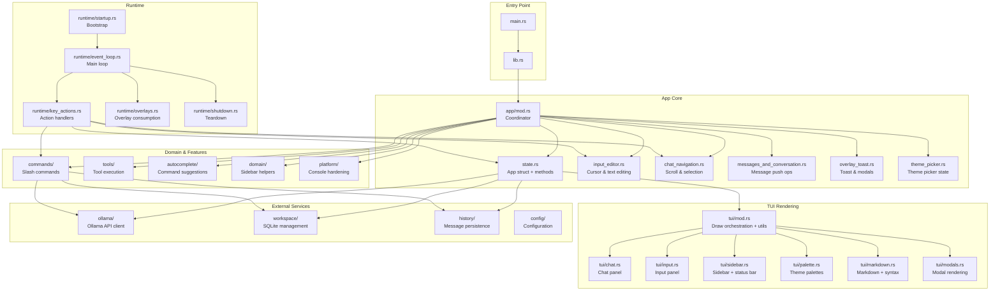
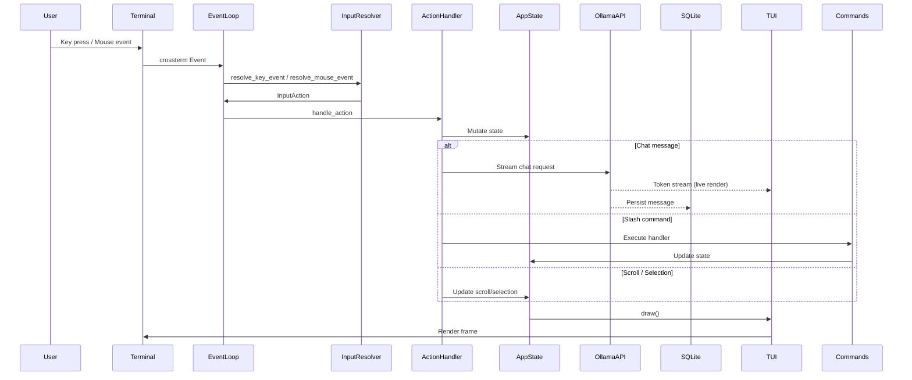

# Architecture

Olly is a Rust terminal UI (TUI) client for Ollama, designed for fast chat workflows with coding-focused features.

## Module Hierarchy

## Data Flow

## Module Responsibilities

### `app/mod.rs` (Coordinator)
- Module declarations and re-exports
- `run()` entry point: bootstrap → event loop → teardown
- Command routing (`handle_command`)
- Autocomplete suggestions
- Help text generators
- Utility functions (`starts_with_ignore_ascii_case`, `unquote_command_value`)

### `app/state.rs` (App State)
- `App` struct definition (35+ fields)
- Constructor (`App::new`) and default state
- UI state snapshot/restore (`snapshot_ui_state`, `apply_ui_state`)
- Session context persistence
- Sidebar entry building and index clamping
- Model/workspace/session management
- Message conversion (`to_ollama_messages`, `from_storage_role`)
- Quit handling with double-press confirmation

### `app/input_editor.rs` (Input Editing)
- Cursor movement (left/right/up/down)
- Character insertion and deletion
- Line/column calculation for multi-line input
- Preferred column persistence for vertical navigation

### `app/chat_navigation.rs` (Scroll & Selection)
- Chat scroll up/down with bounds clamping
- Mouse drag text selection (start/update/end)
- Shift+click range selection
- Drag-to-scroll auto-scroll behavior
- Selection clearing logic

### `app/messages_and_conversation.rs` (Messages)
- `push_user`, `push_assistant`, `push_tool`, `push_system`
- Timestamp normalization
- Conversation loading from SQLite

### `app/overlay_toast.rs` (Overlays & Toasts)
- Toast display and expiration
- Help overlay toggle
- Pending confirmation modals (workspace/session delete, tool actions)

### `app/theme_picker.rs` (Theme Picker)
- Theme picker state machine
- Next/prev/confirm/cancel navigation

### `app/tui/mod.rs` (Render Orchestration)
- `draw()` function: layout calculation, panel delegation
- Shared utilities: `manual_reflow`, `apply_selection_to_text`, `truncate_*`, `scroll_window`
- Sidebar action hints and marquee behavior

### `app/runtime/` (Runtime)
- `startup.rs`: Terminal initialization, raw mode, config loading
- `event_loop.rs`: Main event loop (80ms tick rate)
- `key_actions.rs`: Input action dispatch and handlers
- `overlays.rs`: Overlay consumption logic
- `shutdown.rs`: Terminal teardown, UI state persistence

## Key Design Decisions

### State Module Size
`state.rs` is ~1,061 lines because it contains the `App` struct and all its methods. Further splitting would fragment the impl block and hurt navigability. The struct has 35+ fields mixing UI state, chat state, and session state, but keeping them together preserves coherence.

### Shared TUI Utilities
Utilities like `manual_reflow`, `apply_selection_to_text`, and `truncate_*` remain in `tui/mod.rs` because they're used by multiple submodules (chat.rs, input.rs, sidebar.rs). Extracting them would create circular dependencies.

### Selection State Storage
`chat_visual_lines` stores `Vec<(String, Option<Alignment>)>` — plain text with alignment per visual line. This enables accurate mouse-to-character mapping for text selection, accounting for right/center-aligned messages.

### Auto-Scroll Integration
Auto-scroll runs inside `tick()` (every 80ms) during drag selection. `scroll_up_preserve_selection` and `scroll_down_preserve_selection` methods exist to avoid clearing selection during auto-scroll, while regular scroll methods clear it.

## Tool System

### Design Decisions

| Decision | Value | Rationale |
|----------|-------|-----------|
| Default policy | `off` | Existing users must not be surprised by autonomous behavior |
| Policy modes | `auto` \| `confirm` | Runtime toggleable, persisted in UI state |
| Max tool-loop steps | 4 per message | Prevents runaway loops while allowing multi-step reasoning |
| Workspace boundary | Sandboxed to active workspace root | Prevents accidental file system traversal |
| Command timeout | 60 seconds default | Prevents hung processes |
| Output cap | 10KB stdout/stderr combined | Prevents memory issues from large output |

### Tool Safety Model

**Command execution:**
- Allowlist roots only: `cargo`, `git`, `rg`, `python`, `node`
- Denylist patterns: `rm`, `del`, `format`, `fdisk`, `dd`, destructive git operations
- Path-like executable tokens rejected (`/`, `\`, or leading `.`)
- Only `.exe`, `.cmd`, `.bat` wrapper suffixes normalized
- Dotted suffix forms like `git.evil` rejected
- CWD must be within workspace root

**Async runtime:**
- Command tool uses `tokio::process::Command` (async, non-blocking)
- Filesystem work uses `tokio::task::spawn_blocking` for I/O-heavy operations
- Cancellation via `tokio_util::sync::CancellationToken`
- UI remains responsive during long operations

**Model capability fallback:**
- If tool-enabled request fails with HTTP 400/422, retry once without `tools` array
- Surface system notice: "Model may not support tools - falling back to standard chat"
- Tool metadata still stored even if model returns empty tool_calls

### First Tool Set (MVP)

| Tool | Risk Level | Description |
|------|------------|-------------|
| `read_file` | Read-only | Read file contents with optional offset/limit |
| `list_dir` | Read-only | List directory entries |
| `grep_search` | Read-only | Pattern search (using regex) |
| `find_by_name` | Read-only | Find files by glob pattern |
| `execute_command` | Shell | Restricted command execution (allowlist only) |

### Tool Result Format

- **Success**: `{"status": "success", "output": "...", "truncated": false}`
- **Error**: `{"status": "error", "error": "...", "type": "path_denied|not_found|timeout|..."}`
- **Rendering**: Compact single-line in chat (truncated), full in persistence

## Dependencies

| Module | Depends On |
|--------|-----------|
| `app/state.rs` | `tools/`, `config/`, `ollama/`, `workspace/` |
| `app/runtime/*` | `app/state.rs`, `app/input.rs`, `app/commands/` |
| `app/tui/*` | `app/state.rs`, `app/domain/` |
| `app/commands/*` | `app/state.rs`, `ollama/`, `workspace/`, `history/` |
| `app/tools/` | `app/state.rs`, `ollama/` |
