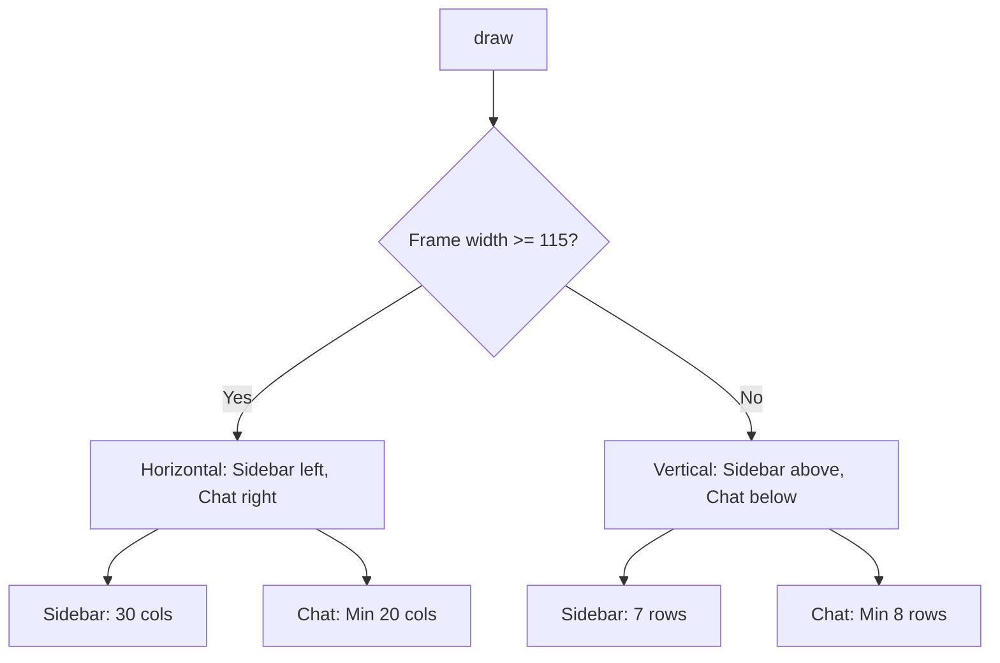
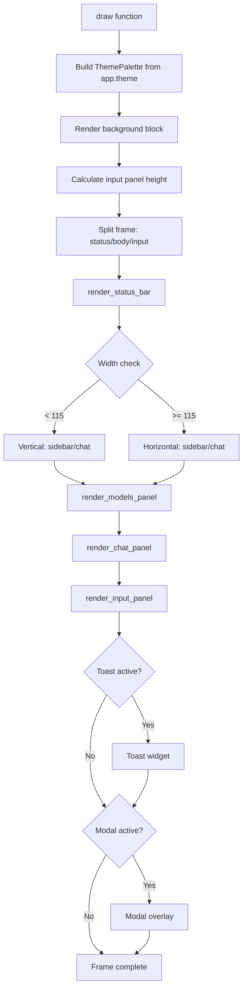
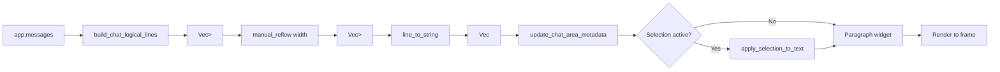
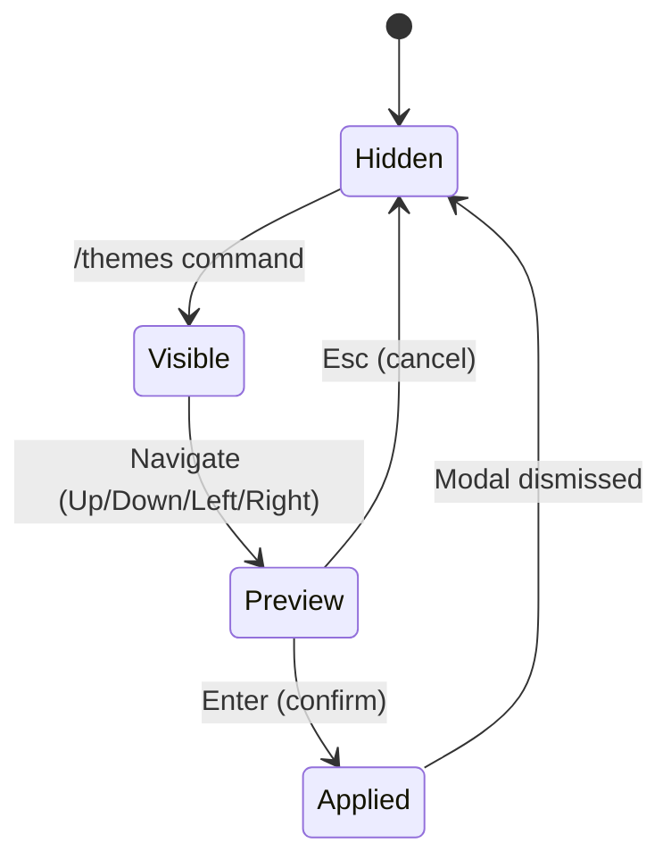
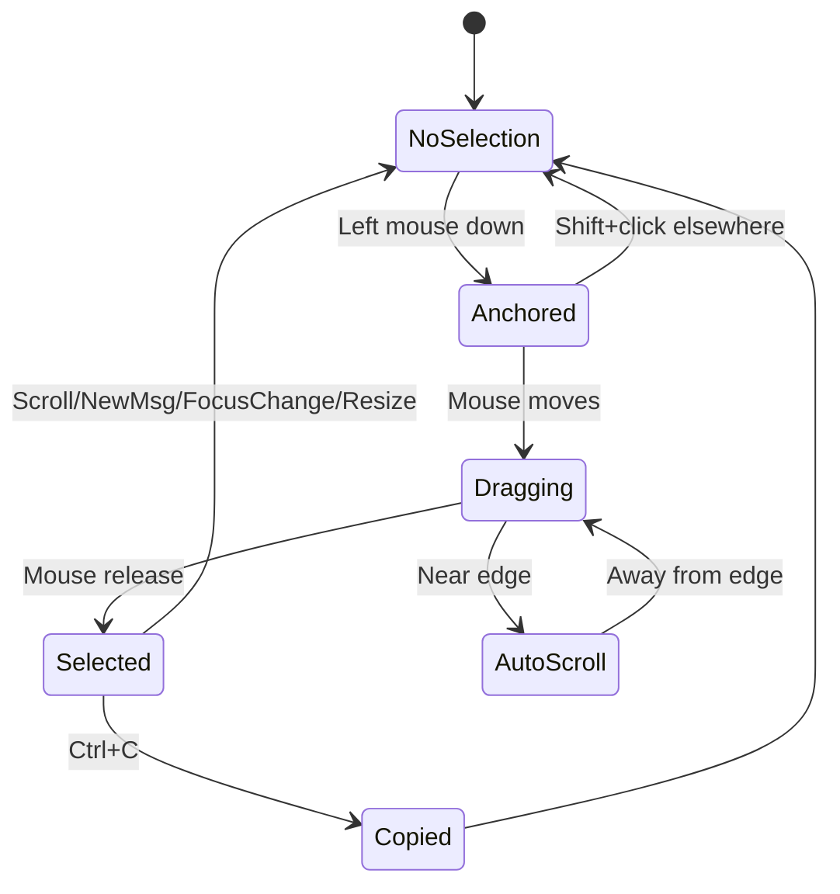

# Design & UI/UX

Olly's terminal UI design principles, rendering pipeline, and interaction patterns.

## Layout Structure

```
┌─────────────────────────────────────────────────────────────────┐
│ Status Bar (1 row)                                              │
├──────────────┬──────────────────────────────────────────────────┤
│              │                                                  │
│ Sidebar      │ Chat Panel                                       │
│ (30 cols)    │ (remaining width)                                │
│              │                                                  │
│ • Models     │ You: message text                    right-aligned│
│ • Workspaces │ Assistant: response text           left-aligned   │
│              │ System: notices                    center-aligned │
│              │ Tool: execution results            left-aligned   │
│              │                                                  │
├──────────────┴──────────────────────────────────────────────────┤
│ Input Panel (3+ rows, dynamic height)                           │
│ > Type your message...                                          │
│                                                                 │
└─────────────────────────────────────────────────────────────────┘
```

### Responsive Layout



## Rendering Pipeline



## Chat Rendering

### Message Alignment

| Role | Alignment | Visual Style |
|------|-----------|-------------|
| You (user) | Right | Distinct styling |
| Assistant | Left | Default body text |
| System | Center | Muted color |
| Tool | Left | Labeled with tool name |

### Text Reflow

Chat text uses manual reflow to support text selection:



### Manual Reflow Algorithm

The `manual_reflow` function replicates ratatui's `Wrap { trim: false }` behavior:

1. For each logical line:
   - If line width ≤ available width, keep as-is
   - If line exceeds width:
     - Break at word boundaries (spaces)
     - If single word exceeds width, break mid-word at character boundary
     - Split style spans at break points, clone styles for both parts
2. Each visual line retains the original line's alignment
3. Width measured as sum of `span.content.chars().count()`

## Theme System

### Palette Structure

Each theme defines a `ThemePalette` struct with color tokens:

```rust
pub struct ThemePalette {
    pub bg: Color,
    pub fg: Color,
    pub border: Color,
    pub border_active: Color,
    pub sidebar_bg: Color,
    pub sidebar_fg: Color,
    pub sidebar_selected_bg: Color,
    pub sidebar_selected_fg: Color,
    pub chat_bg: Color,
    pub chat_fg: Color,
    pub user_msg_bg: Color,
    pub user_msg_fg: Color,
    pub assistant_msg_bg: Color,
    pub assistant_msg_fg: Color,
    pub system_msg_fg: Color,
    pub input_bg: Color,
    pub input_fg: Color,
    pub input_cursor: Color,
    pub toast_fg: Color,
    pub toast_info_bg: Color,
    pub toast_success_bg: Color,
    pub toast_error_bg: Color,
    pub body_muted: Color,
    pub status_bar_bg: Color,
    pub status_bar_fg: Color,
}
```

### Theme Picker

The `/themes` command opens a modal with live preview:



## Selection & Copy

### Visual Highlighting

Selected text is rendered with `Style::default().add_modifier(Modifier::REVERSED)`, which inverts foreground/background colors — visible across all themes.

### Selection States



### Alignment-Aware Column Mapping

Mouse coordinates are mapped to character positions accounting for alignment:

- **Left-aligned**: `col_index = mouse_x - area.x`
- **Right-aligned**: `col_index = mouse_x - (area.x + area.width - line_width)`
- **Center-aligned**: `col_index = mouse_x - (area.x + (area.width - line_width) / 2)`

Clicks outside the rendered text span (in horizontal margins) return `None` to prevent spurious selection.

## Modal System

### Modal Types

| Modal | Trigger | Dismiss |
|-------|---------|---------|
| Help | F1 | Esc |
| Workspace Delete | `/workspace delete` | Esc/Enter |
| Session Delete | `/session delete` | Esc/Enter |
| Theme Picker | `/themes` | Esc/Enter |
| Tool Confirmation | Tool execution (confirm policy) | Esc/Enter |

### Layering Order

```
Top:    Modals (help, delete confirmations, theme picker, tool confirm)
        Toast notifications
Middle: Input panel
        Chat panel
        Sidebar
Bottom: Status bar
        Background
```

## Input Panel

### Dynamic Height

The input panel expands based on content:
- Minimum: 3 rows
- Maximum: `frame.height / 2`
- Grows with newlines and wrapped lines

### Cursor Behavior

- Multi-line navigation with preferred column persistence
- Visual cursor position accounts for wrapping
- Screen position calculation considers visible scroll window

## Marquee Behavior

Long sidebar entries (workspace names, session titles) use marquee scrolling:

- **Unselected**: Truncated with `...` suffix
- **Selected**: Animated marquee with separator (`   `) between repeats
- **Scroll speed**: 1 frame per tick (80ms), offset by `frame / 2`
- **Static prefix**: First 4 characters remain fixed (e.g., `> Wo...`)

## Console Hardening

Windows-specific console behavior:
- Native scrollbar reduction
- Layout artifact prevention
- Resize event handling
- Mouse capture with `crossterm::execute!(EnableMouseCapture)`
- Raw mode via `crossterm::terminal::enable_raw_mode()`
