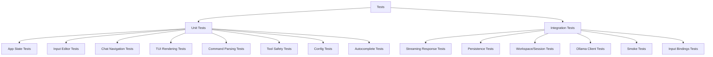

# Testing

Olly's test strategy, organization, and patterns.

## Test Categories



## Test Locations

| Location | Type | Coverage |
|----------|------|----------|
| `src/app/mod_tests/` | Unit | App-level logic (11 files) |
| `src/app/tui/mod.rs` (inline) | Unit | TUI rendering utilities |
| `src/app/tui/modals.rs` (inline) | Unit | Modal rendering |
| `src/app/input.rs` (inline) | Unit | Input action resolution |
| `src/app/runtime/key_actions.rs` (inline) | Unit | Selection/scroll handlers |
| `tests/` | Integration | End-to-end scenarios |

## Running Tests

```bash
# All tests
cargo test --all-targets --all-features

# Or use the convenience scripts:
./scripts/test-unit.ps1              # Unit tests only (fast)
./scripts/test-integration.ps1       # Integration tests only
./scripts/test-unit.ps1 some_pattern # Filter by test name
```

## Quality Gates

All checks must pass before merging:

```bash
# PowerShell
./scripts/check.ps1

# Bash
./scripts/check.sh
```

This runs:
1. `cargo fmt --all -- --check` - Formatting
2. `cargo clippy --all-targets --all-features -- -D warnings` - Linting
3. `cargo build` - Compilation
4. `cargo test --all-targets --all-features` - All tests

### Additional Quality Scripts

| Script | Purpose |
|--------|---------|
| `scripts/fmt-fix.ps1` | Apply formatting and clippy auto-fixes |
| `scripts/coverage.ps1 --html` | Generate HTML coverage report |
| `scripts/audit.ps1` | Check dependencies for vulnerabilities |
| `scripts/docs-check.ps1` | Verify documentation health |
| `scripts/loc.ps1` | Count lines per module |

## Test Organization

### App State Tests (`src/app/mod_tests/`)

| File | Coverage |
|------|----------|
| `autocomplete.rs` | Command suggestion cycling |
| `chat_navigation.rs` | Scroll bounds, selection clearing |
| `input_editor.rs` | Cursor movement, text editing |
| `messages.rs` | Message push operations |
| `overlay_toast.rs` | Toast expiration, modal states |
| `paste.rs` | Mouse event resolution, clipboard |
| `regressions.rs` | Bug fix verification |
| `sidebar.rs` | Sidebar selection, collapse behavior |
| `state.rs` | App construction, state mutation |
| `theme_picker.rs` | Theme picker navigation |
| `tools.rs` | Tool execution, safety controls |

### TUI Tests (inline in `src/app/tui/mod.rs`)

| Test Group | Coverage |
|------------|----------|
| `truncate_*` | Text truncation utilities |
| `scroll_window` | Marquee scrolling |
| `sidebar_action_hint` | Context-sensitive hints |
| `sidebar_marquee` | Long text marquee behavior |
| `estimate_input_visual_lines` | Input height calculation |
| `input_panel_height` | Dynamic input panel sizing |
| `input_cursor_*` | Cursor position calculation |
| `calculate_scroll_position` | Scroll offset math |
| `manual_reflow` | Text wrapping algorithm |
| `apply_selection_to_text` | Selection highlighting |

### Integration Tests (`tests/`)

| File | Coverage |
|------|----------|
| `streaming_parser.rs` | Ollama streaming response parsing |
| `persistence.rs` | SQLite message storage |
| `workspace.rs` | Workspace CRUD operations |
| `config.rs` | Config loading and defaults |
| `ollama.rs` | Ollama API client behavior |
| `smoke.rs` | Boot and basic functionality |
| `tools.rs` | Tool execution integration |
| `input_keybindings.rs` | Key/mouse event resolution |

## Testing Patterns

### App Construction

Most tests use `App::new()` with default values:

```rust
let mut app = App::new(
    String::from("http://localhost:11434"),
    String::from("llama3.2:latest"),
);
```

### Deterministic Tests

Tests must be deterministic with no network dependency:

```rust
// Good: Uses mock data
#[test]
fn scroll_up_caps_at_max() {
    let mut app = App::new(url, model);
    app.chat_max_scroll_hint.set(10);
    app.chat_scroll = 10;
    app.scroll_up(5);
    assert_eq!(app.chat_scroll, 10); // Clamped
}

// Bad: Makes real API calls
#[test]
fn fetch_models_from_ollama() { ... } // Don't do this
```

### Inline Module Tests

Tests live in `#[cfg(test)] mod tests` blocks within their source files:

```rust
#[cfg(test)]
mod tests {
    use super::*;

    #[test]
    fn test_name() {
        // ...
    }
}
```

### App-Level Tests

Tests in `src/app/mod_tests/` are organized as submodules:

```rust
// src/app/mod_tests/mod.rs
mod autocomplete;
mod chat_navigation;
mod input_editor;
// ...
```

## Test Coverage Guidelines

### Every Bug Fix Needs a Test

When fixing a bug, add a test that:
1. Reproduces the bug (fails before the fix)
2. Verifies the fix (passes after)

### High-Risk Areas Need Extra Coverage

- **Input editing**: Cursor movement with multi-line, unicode
- **Scroll bounds**: Edge cases at top/bottom
- **Selection**: Cross-line, alignment-aware, auto-scroll
- **Persistence**: State restoration across restarts
- **Tool safety**: Path injection, executable validation

### What Not to Test

- UI rendering pixel-by-pixel (use manual smoke tests)
- Real network calls (use mock data)
- Third-party library behavior
- Platform-specific console initialization

## Adding New Tests

1. **Unit test for existing logic**: Add to the appropriate `mod_tests/` file or inline `#[cfg(test)]` block
2. **Integration test**: Add a new file in `tests/`
3. **Regression test**: Add to `src/app/mod_tests/regressions.rs`

## Current Test Count

As of v0.0.13:
- **Unit tests**: ~190
- **Integration tests**: ~132
- **Total**: ~322
