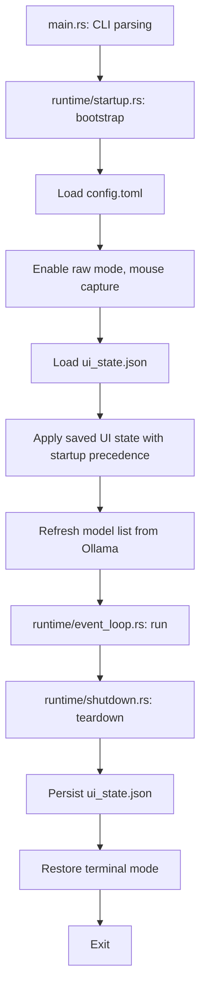
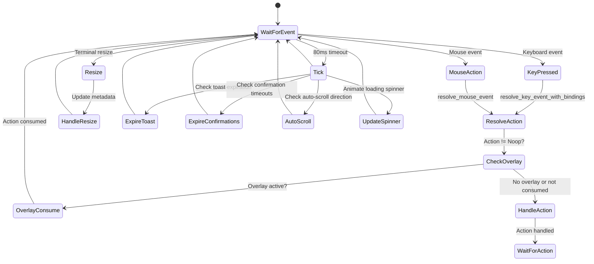
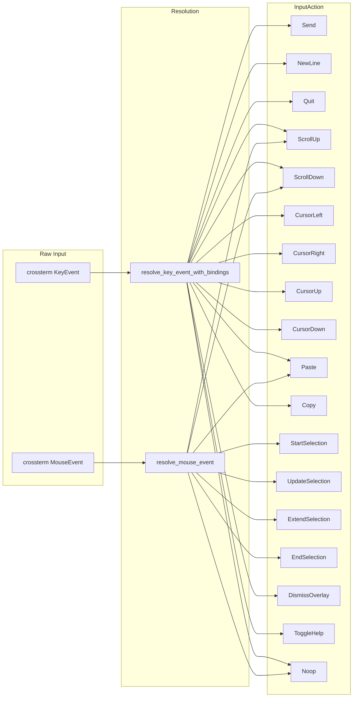
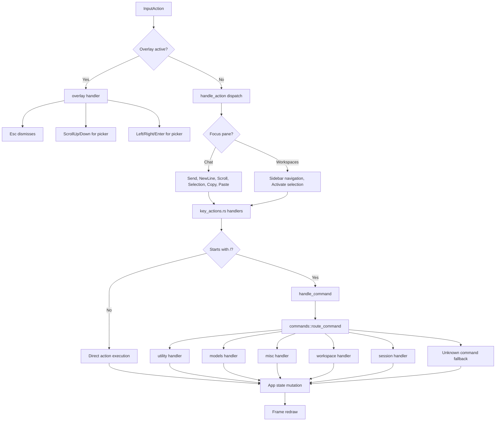
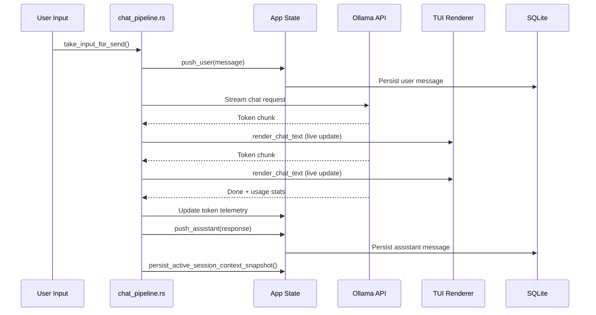
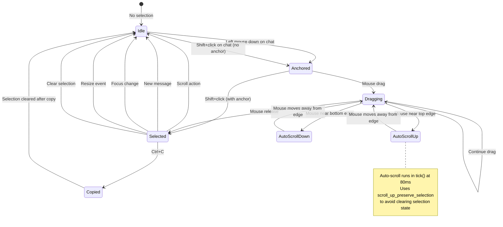
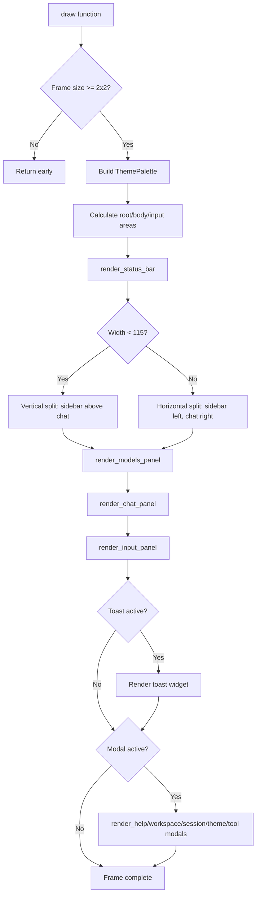
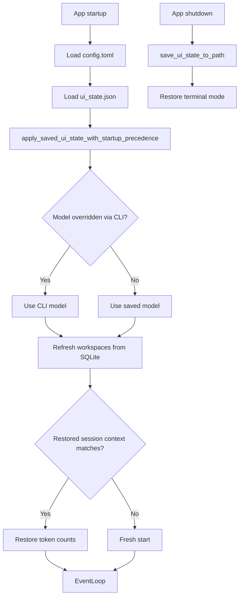

# Workflow

How Olly processes input, renders output, and manages state through its event loop.

## Application Lifecycle

## Event Loop

The event loop runs at a fixed tick rate of 80ms (12.5 Hz) and processes three types of events:

## Input Resolution Pipeline

## Action Handling

## Chat Send Pipeline

## Text Selection Workflow

## Rendering Cycle

## Persistence Flow

## Tick Processing

Every 80ms, the following occurs:

1. **Spinner animation**: `spinner_frame` increments for loading indicator
2. **Toast expiration**: Checks if `toast.expires_at` has passed
3. **Confirmation expiration**: Checks if pending modal timeouts have expired
4. **Auto-scroll**: If `auto_scroll_direction` is set during drag selection, applies scroll while preserving selection state
